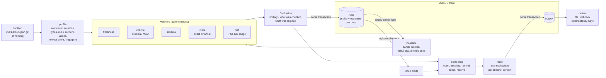
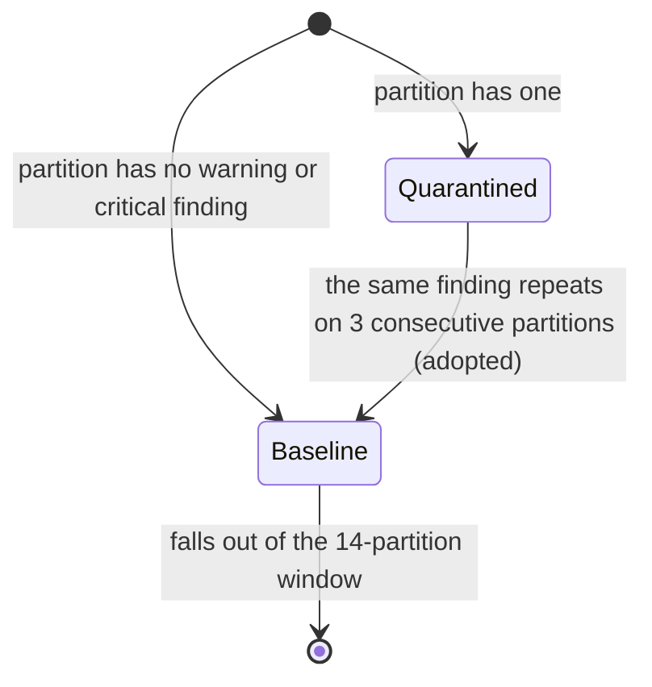
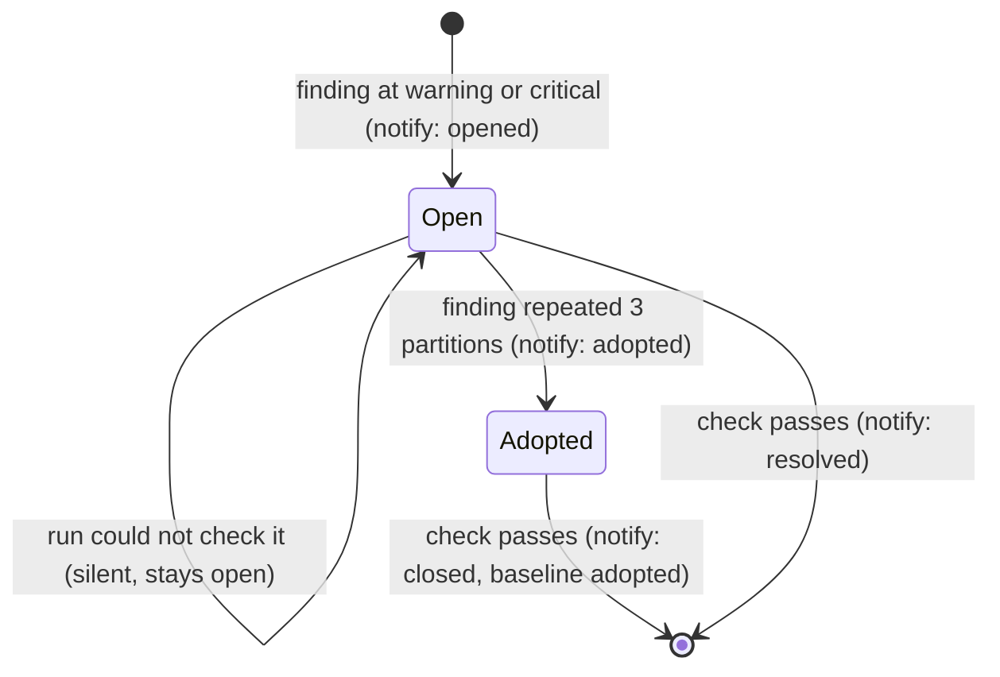
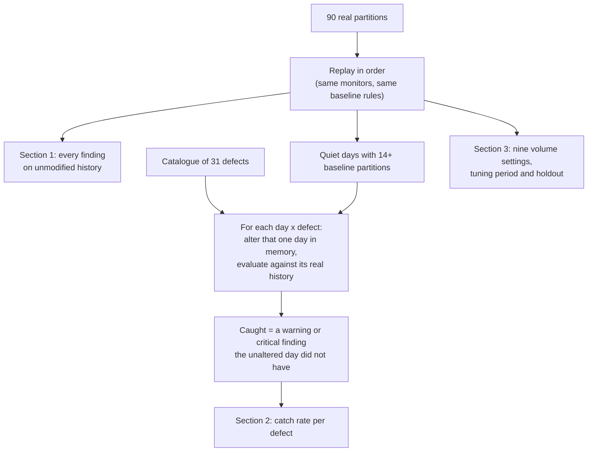

# Architecture

A run checks one dataset for one partition date. It reduces the partition to a profile, compares
the profile with a baseline of earlier profiles, turns the findings into alert transitions and
queues notifications. The backtest calls the same monitor code with altered partitions.

## One run

Nothing but `runs` and `outbox` is stored. The baseline and the open alerts are rebuilt by
replaying earlier runs, so they cannot disagree with the history
([ADR 0005](adr/0005-alerts-derived-from-run-history.md)).

## The monitors

| Monitor | Compares | Fires when | Needs |
|---|---|---|---|
| freshness | the date with what arrived; the partition with the previous one | no partition (critical on the second day in a row); records identical to the previous partition; records changed but no event is newer | nothing, or one earlier partition |
| volume | row count with the last 14 baseline partitions | modified z-score at or beyond the cut-off, or zero rows | 7 baseline partitions |
| schema | columns and JSON types with the last 14 baseline partitions | column removed or type changed (critical); column added or first values in an always-null column (info) | 1 baseline partition |
| nulls | each column's null rate with the pooled baseline rate | the rate moved at least 25 points and an exact binomial test gives p < 0.001 | 7 baseline partitions |
| drift | each numeric column's values with the pooled baseline values | a value more than 3 range-widths outside anything seen; or PSI of at least 0.25 with p < 0.001; or a KS test with p < 0.001 | 30 baseline values for the range check; also 7 partitions and 8 values today for the distribution tests |

Every monitor reports which checks it could not run. An evaluation carries three things:
findings, the keys that were really checked, and notes on what was skipped.

## The baseline

A quarantined partition is stored and reported, but later partitions are not compared with it.
Freshness findings do not quarantine: a late or repeated file says nothing about its content.

## Alert lifecycle

Informational findings never open an alert. They are sent once as notices to whichever channel
the routes give them, usually a digest.

## The backtest

Each trial is independent. The altered day never enters any baseline, so one defect cannot hide
or reveal another, and the catch rate of each defect can be read on its own.
